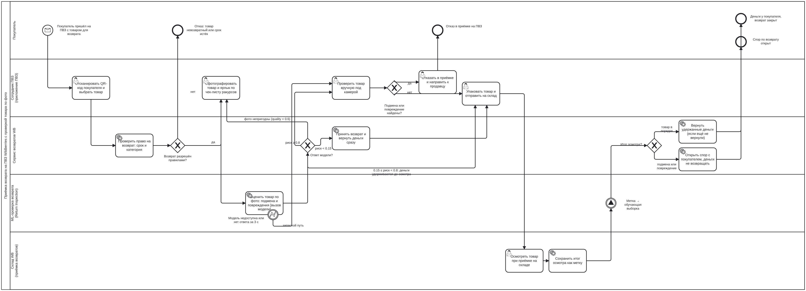
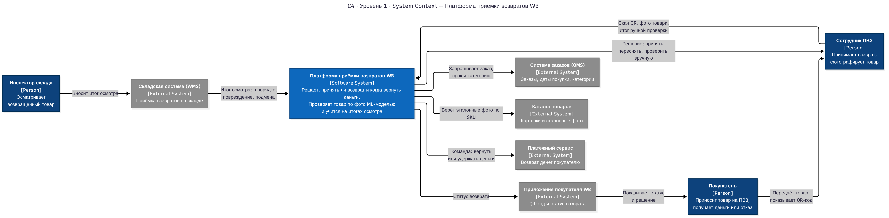
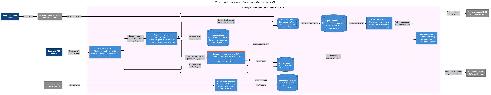
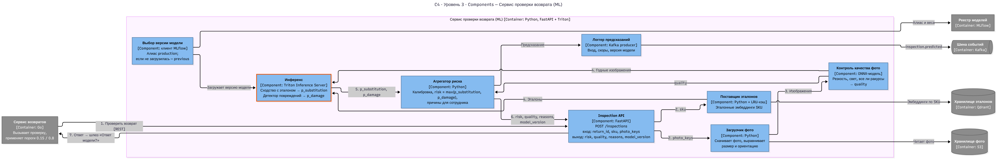

# Приёмка возврата на ПВЗ Wildberries с проверкой товара по фото

**Процесс.** Покупатель приносит товар на ПВЗ, сотрудник фотографирует его, модель оценивает риск подмены и повреждения. Итог: деньги возвращены сразу, деньги возвращены после осмотра на складе, открыт спор или в приёмке отказано.

**Модель.**
- Вход: фото товара с ПВЗ, SKU и эталонные фото карточки.
- Выход: `p_substitution`, `p_damage`, качество фото `quality`, `risk = max(p_substitution, p_damage)`, `model_version`.
- Зачем бизнесу: не проверять вручную каждый возврат, быстро возвращать деньги честным покупателям и не платить за подменённый товар.

**Кто получает результат:** сервис возвратов. Он применяет пороги, и от его решения зависят сотрудник ПВЗ, платёжный сервис и покупатель.

**Границы.** Входит один возврат на ПВЗ от прихода покупателя до денег или спора, включая обучение на итогах осмотра. За рамками: возврат из дома, разбор спора с продавцом, устройство внешних систем, мониторинг модели.

## Пороги и запасной путь

| Условие | Решение |
|---|---|
| `quality < 0.6` | переснять фото (до 2 раз, потом ручная проверка) |
| `risk < 0.15` | принять, вернуть деньги сразу |
| `0.15 ≤ risk < 0.8` | принять, деньги удержать до осмотра на складе |
| `risk ≥ 0.8` | ручная проверка сотрудником |
| модель недоступна или нет ответа за 3 с | ручная проверка |

Модель сама не отказывает: отказ на ПВЗ принимает только человек. Если текущая версия модели не загрузилась, используется предыдущая.

**Разметка для обучения:** итог осмотра на складе («в порядке» / «повреждение» / «подмена») сохраняется как метка, через Kafka попадает в обучающую выборку, и новая модель публикуется, только если она не хуже текущей.

## Схемы

| Схема | Исходник | Картинка |
|---|---|---|
| BPMN | `diagrams/bpmn/wb-return-inspection.bpmn` | `.png`, `.svg` |
| C4 Context | `diagrams/c4/c1-context.mmd` | `.png`, `.svg` |
| C4 Containers | `diagrams/c4/c2-containers.mmd` | `.png`, `.svg` |
| C4 Components (ML-блок) | `diagrams/c4/c3-components-inspection.mmd` | `.png`, `.svg` |

`.bpmn` открывается в [demo.bpmn.io](https://demo.bpmn.io) или Camunda Modeler, `.mmd` — в [mermaid.live](https://mermaid.live).

**Легенда C4:**
- тёмно-синий — человек;
- синий — система;
- голубой — контейнер;
- светло-голубой — компонент;
- серый — внешняя система или соседний контейнер;
- цилиндр — хранилище, горизонтальный цилиндр — очередь;
- **оранжевая рамка** — где считается модель;
- цифры на связях — порядок шагов.

**Легенда BPMN:**
- человечек — задачу выполняет человек;
- шестерёнка — задачу выполняет система;
- молния — ошибка (модель недоступна);
- треугольник — сигнал метки для обучения.

## Соответствие BPMN и C4

| Задача BPMN | Контейнер C4 |
|---|---|
| Отсканировать QR-код; Сфотографировать товар; Проверить вручную; Отказать; Упаковать и отправить | Приложение ПВЗ |
| Проверить право на возврат; шлюзы «Возврат разрешён?» и «Ответ модели?»; Вернуть деньги; Открыть спор | Сервис возвратов (+ OMS, Платёжный сервис) |
| **Оценить товар по фото [вызов модели]**, ошибка «Модель недоступна» | **Сервис проверки возврата (ML)** — внутри схема Components |
| Осмотреть товар на складе | WMS (внешняя) |
| Сохранить итог осмотра как метку → сигнал в обучение | Шина событий → Обучающая выборка → Пайплайн обучения → Реестр моделей |

## Допущения

1. Сотрудник ПВЗ фотографирует возврат в приложении по чек-листу, и фото уходят в WB.
2. Решение поддерживает ML-модель, сравнивающая фото с эталонами карточки.
3. Модель не отказывает сама — это мой регламент.
4. Пороги 0.15 / 0.8 / 0.6, таймаут 3 с, 2 пересъёмки — мои значения.
5. При среднем риске деньги удерживаются до осмотра. Реальный регламент WB неизвестен.
6. Каждый принятый возврат осматривается на складе, итог — одна из трёх меток.
7. Технологии контейнеров (Go, Python, Triton, Qdrant, MLflow, Kafka, ClickHouse, Airflow) — типичный стек, реальный не публиковался.

## Источники

- [Т—Ж](https://t-j.ru/tovar-proveriat-pod-kameroi-hate/): на ПВЗ WB товар проверяют под камерой, при возврате его осматривают ещё раз.
- [Oborot.ru](https://oborot.ru/blogs/wildberries-testiruet-prostoj-vozvrat-kak-izmenitsya-rabota-punktov-vydachi-i268590.html): в интерфейсе ПВЗ есть отметки «Проверить только на подмену» и «Требует проверки»; при подмене сотрудник отказывает и направляет к продавцу; принятый товар отправляют на склад; срок возврата — 14 дней.

**Придумано мной:** ML-проверка и её место в процессе, пороги, запасные пути, удержание денег, путь метки в обучение, все контейнеры и компоненты на C4. Готовые схемы не использовались.
